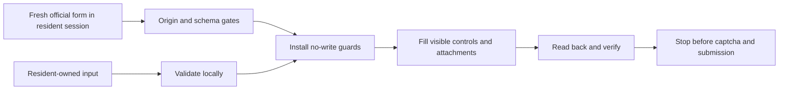

# Givatayim resident form fill-only adapter

Issue #274. Status: design before implementation. Target: 2026-11-04.

## Boundary

Fill the official form for the resident's own identity in a caller-owned browser
session. Never submit a report. No identity fallback, stored profile, login,
secret collection, direct HTTP transport, captcha solving or token replay.
No production acceptance is claimed before a separately authorized real case.

## Interface

An optional Playwright dependency supplies a synchronous Page. The caller opens
the official page first. `fill_resident(page, ResidentReport(...))` installs
persistent page request and form-submit guards, checks exact origin/path and
form action/method/enctype, validates all required fields and attachment limits,
selects the resident branch, fills its conditional controls and advances one
step. It verifies the incident values, then returns counts and an explicit
`submission_enabled=False`. There is no submit method or flag.

The adapter rejects existing populated fields, conflicting resident selection,
missing/duplicate/changed controls, disabled/read-only controls except the city,
invalid street IDs, optional stale hidden values supplied by a caller, oversized
text or files, file symlinks, and non-image attachments in the initial scope.
Resident ID validation is numeric length only; neither logs nor errors echo it.
The resident, not the code, is accountable for ownership of the supplied details.
The adapter does not claim to authenticate the resident's identity.

## Safety

- Official origin: HTTPS `www.givatayim.muni.il`, exact `/moked/`, no query.
- Reject service-worker-enabled contexts because request interception must cover
  page requests. Caller creates context with `service_workers='block'`.
- While filling, abort all non-GET/HEAD requests and all document navigation.
  Do not allow captcha verification, telemetry POSTs or uploads as side effects.
- A form submit event is prevented; its submit button is disabled at completion.
  Guards remain until the caller closes the page. Caller must not remove guards
  or reuse that page for a real submission.
- Hidden session/CSRF/captcha values are never read, filled, stored or returned.
- Form drift or partially filled state fails closed. After a partial failure,
  close the page and start from a fresh official form, no automatic retry.
- No persistent applicant data or screenshots by default. Diagnostics contain
  stage codes only. Synthetic fixtures use variable names and invalid identifiers.

## Verification

Unit input tests plus synthetic two-step form E2E in Chromium and WebKit.
Intercept the official URL with a local fixture, never use the municipality as
a test target. Tests verify resident fields, dynamic requirements, attachments,
unchanged hidden values, zero write requests and submit protection. Negative
cases cover origin/action/schema drift, prefilled fields and validation errors.
Synthetic screenshots are CI artifacts. A container target runs both engines;
existing container tests continue running the ordinary suite.

## Known limits

The external Smart Form script was not readable during research. The fixture
models only the observed controls and conditional resident branch, not that
script's complete behavior. Filling the real site, captcha completion and
receipt mapping remain unverified. The resident branch's identity/address fields
are required by this adapter even if the site relaxes them. No reporting category
field exists in the supplied snapshot. Description limit is 700 characters;
HTML uses client data attributes, so server limits remain unknown.
